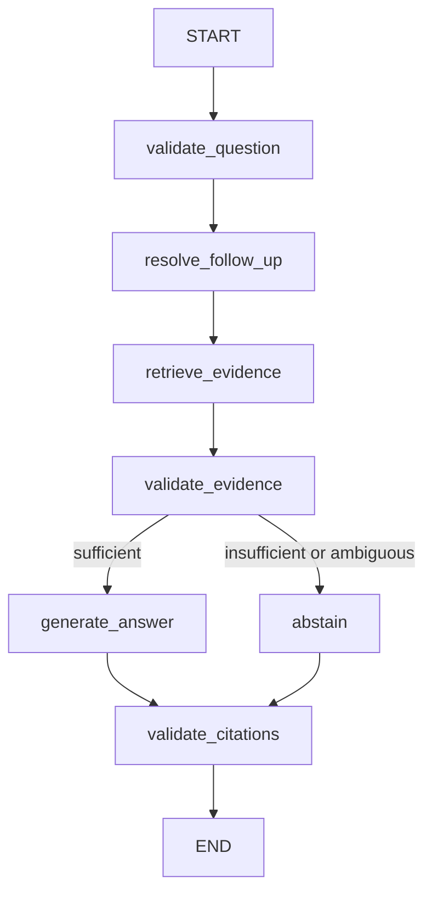

# Day 4 RAG architecture

The active application adds `src/ui_day4.py` to Ask LabRAG. The retrieval explorer,
upload, chunk inspection, indexing and comparison tools remain available.

`src/rag/rag_graph.py` constructs a LangGraph StateGraph. Every question, including a
follow-up, calls the existing SemanticRetriever with the selected strategy and top-k.
Chat searches both the full instruction question and a separate test-identity query,
derived from user-supplied codes/name words. It merges their results and prioritizes
pages with matching test labels before bounded context expansion. This prevents generic
specimen/storage matches from occupying all expansion slots when a small heading chunk
ranks lower. The two searches retain the configured namespace and embedding model.
Identity search terms and initial result counts are visible under Retrieval details.

Only previous user questions and their resolved queries establish conversation context;
previous assistant answers never enter the evidence prompt. At least five recent turns
are retained in Streamlit session state, bounded by RAG_MAX_HISTORY_TURNS. Clear conversation
discards them. Conversation history is not written to disk.

Because existing catalog chunks often have unresolved test metadata, chat optionally
expands the top three distinct seed pages with preceding/current/following indexed pages.
Each page query is capped at 100 vectors (at most nine read-only queries). This uses the
same Pinecone index, namespace, public corpus and embedding-model filter. It does not
rerank, create vectors, read local PDFs as answer evidence or change vector metadata.
Contiguous source character offsets, consistent overlapping text and a printed page footer
must establish page coverage before in-memory test identity enrichment. Recognized test
headers delimit regions; unknown headers stop attribution. A complete preceding indexed
page can establish a continuation's identity. Missing spans or unresolved boundaries
cause conservative abstention. Page expansion can increase latency and Pinecone reads.

Exact test codes take priority. Name matching requires identifying words, and ambiguous
matches require clarification. Comparisons require independently identified tests. A
lexical question-facet check screens for specimen, preparation, stability, volume and
orderability. Similarity scores are not confidence. These conservative rules can reject
valid questions and do not prove clinical completeness or semantic entailment.

GroqService constructs ChatGroq lazily, with a 30-second request timeout and two SDK
retries for transient failures. Function-calling structured output selects exact supporting
excerpts and source IDs. This avoids assuming strict JSON-schema support for every model.
Unsupported models/authentication failures return sanitized actionable errors. Other
providers can implement `select(messages)` and return AnswerSelection; only Groq is
currently configured through the UI. No client/model is initialized on startup.

The answer renderer displays **verbatim checked excerpts**, rather than unchecked clinical
paraphrases. Every excerpt must occur in its scoped retrieved source and every ID must map
to a current-turn chunk. Invalid selections cause abstention. Free model-generated missing
information/conflict descriptions are replaced with generic flags so they cannot introduce
uncited clinical claims. The prompt asks for complete instructions and both sides of a
conflict, but detection of omissions/conflicts is not guaranteed; users must review sources.
No diagnosis or treatment questions are answered.

Before validation, whitespace-only differences from PDF indentation are restored to the
actual indexed substring. Changes to words, values, units, punctuation or case remain
invalid. Known injection instructions cannot themselves be selected as an answer.

Follow-ups without a new identity use a compact identity derived only from prior user
questions/resolved queries, avoiding a growing chain of previous prompts. A new identity
switches tests. Storage/volume questions mentioning “specimen” do not also require a
collection passage unless collection is explicitly requested. Treatment requests follow
the validation → abstain route before any retrieval/generation. Missing exact numeric
transport temperature yields a missing-information abstention with context-only citations.

Citations show test identity, provider, title, chunk ID, section, URL, local PDF page
(one-based), original PDF ordinal where present, and printed catalog page separately.
Printed pages come from an explicit metadata field or a retrieved page footer; unknown
values remain Unknown. No offset-based page number is invented. The evaluation PDF's
printed page 501 was verified as local PDF page 2, which illustrates the distinction.

Retrieved counts include context expansion; source IDs identify evidence views of actual
retrieved chunks. The initial top-k remains the configured seed count. Node timings are
measured with perf_counter; retrieval, LLM, total wall time and citation counts are shown.
RAG_ENABLE_TRACING enables the actual path's timing panel. No external tracing or transcript
logging is enabled. Documents and questions are sent to Groq only on supported submissions;
embedding API requests follow the existing configured embedding provider.

The local PDF validates evaluation reference facts only. Tests use injected services and
synthetic fixtures; they do not establish live model accuracy, retrieval recall or patient
safety. The app is an educational laboratory reference assistant for a partial corpus.

## TC01–TC20 execution

`scripts/validate_day4_corpus.py` verifies clinical excerpts inside the correct test entries,
keeps printed/PDF pages separate, and records the TC17 real-test/local-snapshot audit.
The corpus is only the specified Mayo catalog subset, not the complete catalog.
The completion attachment supplies TC14–TC20; these now replace the prior incomplete-TC14
note. Dataset statuses remain Not Tested until measured results are recorded separately.

`src/evaluation/day4_runner.py` invokes the actual graph per turn, resets history between
cases, validates expected identity/outcome/excerpts/citations, records failures and exports
JSON/CSV. Mock backends are labeled fixtures, not proxy live evidence. TC17 is skipped
unless cloud absence is established. A mocked no-evidence routing test separately verifies
abstention without asserting corpus absence. TC18 blocks provider calls, TC19 tests
missing temperature, and TC20 tests injection/citation rejection with a mock retriever.

Live mode requires both a live command and LABRAG_RUN_DAY4_LIVE=1. Optional --audit-absence
performs a bounded exhaustive read-only audit and checks namespace ID stability. It never
changes the index and cannot certify absence on an incomplete audit. Expected source IDs
are empty; observed IDs are recorded only after actual execution. This continuation runs
mocked validation only. No live follow-up success or clinical accuracy is inferred.

The Evaluation tab reads reports, provides filters, turn inspection, measured counts and
downloads, and only runs mocks on an explicit button press. No live call occurs on load.
Day 5 reranking, recall/MRR, answer faithfulness and citation-quality benchmarks remain
unimplemented; current checks validate workflow behavior and literal source grounding.
